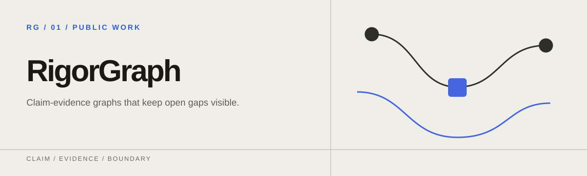
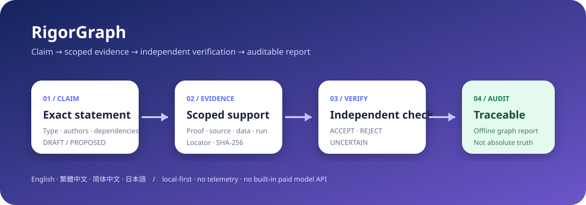

<p align="center">
  
</p>

# RigorGraph

[English](README.md) · [繁體中文](README.zh-TW.md) · [简体中文](README.zh-CN.md) · [日本語](README.ja.md)

**AI リサーチを、監査できる主張と証拠のグラフに変換します。**

RigorGraph は、研究上の主張を、その根拠となる証拠と結び付けたまま管理します。主張ごとに、何を述べているか、どの証拠が支えているか、誰が独立に確認したか、何が未解決かを記録します。証明、文献上の支持、数値証拠、ベンチマーク証拠、不確実性は、それぞれ別の種類として区別します。CLI、オフラインレポート、GitHub Action、スキルパックとして提供され、既定ではローカルだけで動作します。

> RigorGraph が確認するのは、ワークフローが完全で追跡可能かどうかです。`VERIFIED` の主張は、記録されたワークフローで受理されたことを意味します。絶対的な真理、形式認証、査読、専門家の合意を意味するものではありません。

> **製品ステータス：公開ベータ。** 公開済みの 1.x インターフェースは、前方互換な追加変更だけを受けます。外部での利用は証拠の一つですが、決定的な品質ゲートを弱める理由にはなりません。公開フィードバックには非公開の研究データを含めないでください。



## クイックスタート

Python 3.11 以降が必要で、API キーは不要です。公開済みの 1.0.1 パッケージをインストールしてください。製品は引き続き公開ベータです。

```bash
python -m pip install "rigorgraph==1.0.1"
rigorgraph --lang ja demo --scenario math --open
```

デモはプロジェクトを作成し、決定的な監査を実行して、自己完結型のレポートを開きます。意図的に無効にした昇格も試せます。

```bash
rigorgraph --lang ja demo invalid-demo --scenario invalid
rigorgraph --lang ja audit invalid-demo
```

2 回目の監査は、有限の数値走査を形式的な証明として扱おうとする試みを拒否します。

### 自分のプロジェクトを作成する

```bash
rigorgraph --lang ja quickstart my-research --name "私の研究プロジェクト" --author "あなたの名前" --type formal --statement "すべての有界数列は性質 P を持つ。" --open
```

このコマンドは、入力した原文のまま実際の `DRAFT` 主張を 1 件作成し、オフラインレポートを開きます。主張は「未解決のギャップ」に表示されます。RigorGraph が証拠を捏造したり、主張を `VERIFIED` に昇格させたりすることはありません。プロジェクトは、人が読めてバージョン管理もできるレコードとして保存されます。

```text
my-research/
├── rigorgraph.yaml
└── .rigorgraph/
    ├── claims.jsonl
    ├── evidence.jsonl
    └── verifications.jsonl
```

## コマンド

| コマンド | 用途 |
| --- | --- |
| `rigorgraph quickstart` | 証拠を捏造せず、最初の `DRAFT` 主張と読みやすいオフラインレポートを作成 |
| `rigorgraph init` | 既存ファイルを上書きせずに初期化 |
| `rigorgraph claim add CLAIM.json` | `DRAFT` または `PROPOSED` の主張を追加 |
| `rigorgraph evidence add EVIDENCE.json` | 範囲を限定した証拠を追加。ローカルファイルには SHA-256 が必須 |
| `rigorgraph verify CLAIM_ID --file REVIEW.json` | 独立した `ACCEPT`、`REJECT`、`UNCERTAIN` を記録 |
| `rigorgraph audit` | 構造、依存グラフ、証拠区分、独立性、ハッシュを確認 |
| `rigorgraph report` | 4 言語を切り替えられるオフライン HTML を生成 |
| `rigorgraph demo` | 有効な数学、ベンチマーク、意図的に無効なデモを作成 |

コマンドの前に `--lang en`、`--lang zh-TW`、`--lang zh-CN`、`--lang ja` を付けると、画面の言語を選べます。指定しない場合は、プロジェクト設定、OS の言語、英語の順に選ばれます。

## 監査が強制するワークフロー規則

- ID は一意で、すべてのリンクが解決できること。
- 主張の依存関係に循環がないこと。
- 取り消された主張や却下された主張が、下流の主張を暗黙のうちに支えないこと。
- 主張の著者が、自分自身の独立検証者にならないこと。
- `VERIFIED` には独立した `ACCEPT` レコードがあること。
- 形式的な主張には証明があり、文献上の主張には正確な出典の位置指定があり、実証やベンチマークの主張には再現に使える成果物があること。
- ローカル証拠のパスがプロジェクトの外を指さず、必須の SHA-256 が一致すること。
- ACCEPT レコードが、実際にレビューした主張と証拠のスナップショットに結び付いていること。
- ワークフローで検証済みの統合主張が、現在 `VERIFIED` である主張だけに依存していること。

利用者が書いた主張、数式、引用、証拠は原文のまま保持され、翻訳されるのは画面のラベルだけです。

## Agent Skills と Codex plugin

このリポジトリには、[research-intake](skills/research-intake)、[capture-claim](skills/capture-claim)、[adversarial-verify](skills/adversarial-verify)、[release-audit](skills/release-audit) の 4 つのスキルと、ネイティブの `.codex-plugin/plugin.json` が含まれています。

Codex では、`$skill-installer` に `f0909172434/rigorgraph` からのインストールを依頼するか、対応しているローカル／plugin marketplace のフローを使ってください。

## プライバシーと制限

- RigorGraph は既定でローカルだけで動作します。アカウント、テレメトリ、リモートのデータベース、組み込みの有料モデル API はありません。
- HTML レポートは自己完結型の単一ファイルで、開いてもネットワーク要求は発生しません。
- 決定的なゲートは、不完全な記録や不正な昇格を検出できます。しかし、人間や AI が書いた証明が数学的に正しいことは保証しません。
- 重要な結果には、その分野の専門家によるレビューが引き続き必要です。

RigorGraph 1.0 では、`rigorgraph evidence import BUNDLE.json --claim ID` で HonestCI などが生成したバージョン付きの証拠バンドルを保存できます。リンクできるのは `DRAFT` または `PROPOSED` の主張だけで、インポートによって主張が自動的に検証されることはありません。仕様の詳細は [Evidence bundles](docs/EVIDENCE_BUNDLES.md) を参照してください。

ソースからの開発、GitHub Action、貢献方法については、[英語 README](README.md) と [CONTRIBUTING.md](CONTRIBUTING.md) を参照してください。セキュリティ上の境界は[セキュリティポリシー](SECURITY.md)と[脅威モデル](docs/THREAT_MODEL.md)に、リリース条件は[リリース方針](docs/RELEASE_POLICY.md)に記載しています。本プロジェクトは MIT License で提供されます。

[ツール連携の例](examples/toolchain/README.md)はそのまま実行できます。HonestCI の成功・失敗・改変の検出、Finite Witness の再検証、保存済みの ProofWeave 証拠を扱います。この例に含まれる主張はすべて DRAFT のままです。
