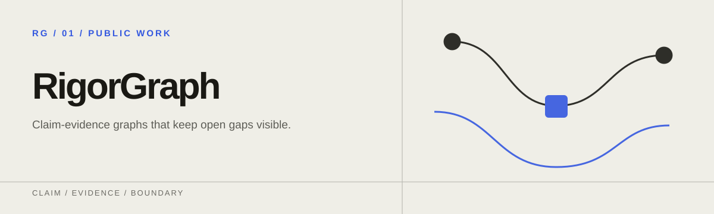
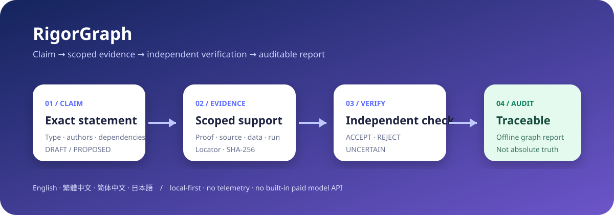
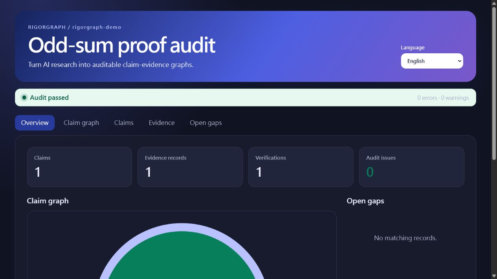

<p align="center">
  
</p>

# RigorGraph

[English](README.md) · [繁體中文](README.zh-TW.md) · [简体中文](README.zh-CN.md) · [日本語](README.ja.md)

[](https://github.com/f0909172434/rigorgraph/actions/workflows/ci.yml)
[](https://github.com/f0909172434/rigorgraph/actions/workflows/codeql.yml)
[](https://pypi.org/project/rigorgraph/)
[](https://pypi.org/project/rigorgraph/)
[](LICENSE)

**Turn AI research into auditable claim-evidence graphs.**

RigorGraph keeps a research claim attached to the evidence it rests on. For each claim it records what the claim says, which evidence supports it, who checked it independently, and what is still open. It keeps proof, literature support, numerical evidence, benchmark evidence and uncertainty as separate kinds of support. You use it through a Python CLI, an offline HTML report, a GitHub Action, or a set of agent skills. The CLI and the report run on your machine and need no account or network service.

> **Truth boundary:** RigorGraph checks that the workflow is complete and traceable. A claim marked `VERIFIED` has been accepted by the recorded workflow. That is not the same as absolute truth, formal certification, peer review, or expert consensus.

> **Compatibility boundary:** RigorGraph is still a public beta. Throughout 1.x, the published CLI flags and JSON output, schemas, stable audit codes, Evidence Bundle v1 fields, GitHub Action inputs and outputs, and plugin interfaces only change in backward-compatible, additive ways. A breaking change requires a new major or schema version.

## What RigorGraph does

| Surface | What you get | What it does not claim |
| --- | --- | --- |
| Claim-evidence graph | Version-controlled JSONL records for claims, dependencies, evidence, and review history | A knowledge base that decides whether a statement is true |
| Deterministic audit | Stable issue codes, JSON output, and configurable process exit behavior | A proof kernel, source-quality judge, or benchmark oracle |
| Evidence integrity | Project-root path checks, SHA-256 byte checks, and accepted-review snapshot binding | Authorship, signer identity, remote-content preservation, or correctness |
| Offline report | A read-only, self-contained HTML view with four interface languages | A hosted or collaborative editor |
| Automation | The same audit through a Python CLI or composite GitHub Action | A model API, autonomous reviewer, or permission sandbox |
| Agent workflow pack | Four skills for intake, capture, adversarial review, and release audit | Automatic promotion of AI output to `VERIFIED` |



## See the result first

The bundled math demo produces the report below. It needs no account or API key and makes no network request while it runs.



The screenshot comes from `rigorgraph demo --scenario math`. The report shows research text in the language it was written in, while the interface can switch between English, Traditional Chinese, Simplified Chinese, and Japanese.

The [report walkthrough](docs/REPORT_WALKTHROUGH.md) shows a valid example and deliberately invalid ones, all exported from real runs, so you can inspect them before installing.

## Quick start (three minutes)

RigorGraph requires Python 3.11 or newer. Install the published 1.0.1 package. The product is still in public beta.

```bash
python -m pip install "rigorgraph==1.0.1"
rigorgraph demo --scenario math --open
```

The demo creates a project, runs a deterministic audit, and opens the offline report. To watch the quality gate reject an invalid promotion, run:

```bash
rigorgraph demo invalid-demo --scenario invalid
rigorgraph audit invalid-demo
```

The second audit rejects an attempt to treat a finite numerical scan as a formal proof.

### Start your own project

```bash
rigorgraph --lang en quickstart my-research --name "My research project" --author "Your name" --type formal --statement "Every bounded sequence has property P." --open
```

This creates one real `DRAFT` claim, in the language you wrote it in, and opens its report. The claim is listed under Open gaps. RigorGraph does not invent evidence for it or promote it to `VERIFIED`.

`quickstart` only captures a claim. It does not move a draft into review. For the full workflow, start with `rigorgraph init`, add a scoped `PROPOSED` claim and its evidence, obtain an independent review record, and then audit. The [end-to-end workflow](docs/WORKFLOW.md) gives copyable JSON for every step and includes a deliberate tamper test.

```text
my-research/
├── rigorgraph.yaml
└── .rigorgraph/
    ├── claims.jsonl
    ├── evidence.jsonl
    └── verifications.jsonl
```

## When RigorGraph fits

RigorGraph is a good fit when you need to:

- keep a version-controlled map from each claim to its scoped proof, literature, computation, data, or benchmark evidence;
- require an independent review record before the workflow can mark a claim `VERIFIED`;
- make incomplete links, changed evidence bytes, stale reviews, and invalid status promotions fail the same way every time;
- generate a read-only report that someone can open offline or that CI can upload;
- keep a versioned HonestCI result as Evidence Bundle v1 without treating that result as a truth claim.

It is not a good fit when you need:

- a theorem prover, a proof assistant kernel, a peer-review service, or a guarantee that a claim is correct;
- a hosted collaborative database, an editable web application, a telemetry dashboard, or a built-in model provider;
- a secrets vault or a safe place to publish private research records;
- a malware sandbox or a permission boundary for hostile code and files.

You can adopt it in three ways without changing the data format:

1. **Local research notebook.** Keep `rigorgraph.yaml`, `.rigorgraph/*.jsonl`, and evidence that is not sensitive in version control, and generate the report when you need it.
2. **Repository quality gate.** Run `rigorgraph audit PROJECT --json` locally, and use the GitHub Action to upload the same report from CI.
3. **Human-plus-agent workflow.** Let the bundled skills structure the records, but keep the evidence and the independent acceptance decision reviewable by a person or another named reviewer.

## Commands

| Command | Purpose |
| --- | --- |
| `rigorgraph quickstart` | Create a first `DRAFT` claim and readable offline report without fabricating evidence |
| `rigorgraph init` | Create a project without overwriting existing files |
| `rigorgraph claim add CLAIM.json` | Add a `DRAFT` or `PROPOSED` claim |
| `rigorgraph evidence add EVIDENCE.json` | Add scoped evidence; local files require a SHA-256 digest |
| `rigorgraph evidence import BUNDLE.json` | Validate and preserve a versioned evidence bundle; optionally link it to a draft claim |
| `rigorgraph verify CLAIM_ID --file REVIEW.json` | Record an independent `ACCEPT`, `REJECT`, or `UNCERTAIN` outcome |
| `rigorgraph audit` | Check schemas, graph integrity, evidence class, independence, and hashes |
| `rigorgraph report` | Generate a four-language offline HTML report |
| `rigorgraph demo` | Create a valid math, valid benchmark, or intentionally invalid demo |

Put `--lang en`, `--lang zh-TW`, `--lang zh-CN`, or `--lang ja` before a command to choose the interface language. Without it, RigorGraph uses the project configuration, then the operating-system locale, then English.

`audit` accepts `--json` for machine-readable output and `--fail-on error|warning|never` to control its exit code. `never` is useful when you only want to observe, but it turns the command into a check that never blocks. The JSON `status` still reports `PASS` or `FAIL`. Project-level defaults live in `rigorgraph.yaml`.

## What the audit enforces

- IDs are unique and every link resolves.
- Claim dependencies contain no cycles.
- A revoked or rejected claim cannot silently support claims that depend on it.
- A claim's author cannot be its independent verifier.
- `VERIFIED` requires an independent `ACCEPT` record.
- Formal claims need proof evidence, literature claims need an exact source locator, and empirical and benchmark claims need artifacts that let someone reproduce them.
- Local evidence paths cannot point outside the project, and their required SHA-256 digests must match.
- An `ACCEPT` record is bound to the exact snapshot of the claim and evidence that it reviewed.
- A verified synthesis depends only on claims that are currently verified.

Claims, formulas, quotations, and evidence stay in the language their author used. Only the interface labels are translated.

The evidence required depends on the claim type:

| Claim type | Required before an accepted claim can audit as `VERIFIED` |
| --- | --- |
| `formal` | `proof` |
| `literature` | `source` with an exact remote locator |
| `empirical` | both `dataset` and `computation` |
| `benchmark` | both `dataset` and `benchmark_run` |
| `synthesis` | at least one dependency, with every dependency currently `VERIFIED` |

The audit checks that the accepted review explicitly listed the required evidence. It does not check whether a proof is logically complete, whether a source is reputable, or whether an experiment was well designed.

## Technical design

A project is plain text plus the evidence files it references:

```text
my-research/
├── rigorgraph.yaml                 # schema version, name, UI language, failure threshold
├── .rigorgraph/
│   ├── claims.jsonl                # graph nodes, statuses, dependencies, evidence links
│   ├── evidence.jsonl              # scoped local or remote evidence metadata
│   ├── verifications.jsonl         # outcomes and bound claim-evidence snapshots
│   └── artifacts/                  # exact imported Evidence Bundle bytes, when used
├── evidence/                       # user-managed local evidence (example convention)
└── rigorgraph-report.html          # generated; contains a readable copy of project data
```

Core project records use strict Pydantic models. Unknown fields, invalid enum values, malformed identifiers, ambiguous evidence locations, and unsupported schema versions all fail when the project loads. Evidence Bundle v1 is deliberately additive: future optional fields are preserved, while the required fields and the profile contract stay fixed.

For local evidence, RigorGraph hashes the bytes of the referenced file. For an accepted review, it separately hashes canonical JSON that contains the claim and every linked evidence record. Status and timestamps are left out of that review snapshot, but the substantive claim and evidence metadata are included. If a file's bytes change later, the audit reports `RG_HASH_MISMATCH`. If the accepted packet changes, it reports `RG_SNAPSHOT_MISMATCH`.

Commands that change an existing project (`claim add`, `evidence add`, `evidence import`, and `verify`) take a per-project lock. Record and bundle writes go to a temporary file first and replace the target only once the write is complete. The report generator embeds the validated records and all four locale catalogs into the bundled viewer, escapes characters that are significant inside a script, and writes a single HTML file. The GitHub Action calls the same loader, audit engine, and report generator as the CLI.

The [technical architecture](docs/ARCHITECTURE.md) covers model fields, lifecycle semantics, audit stages, hashing, write behavior, and trust boundaries. Generated JSON Schemas are in [`schemas/`](schemas/).

## Evidence bundles and interoperability

RigorGraph 1.0 implements the additive, versioned Evidence Bundle v1 contract. An HonestCI run can emit a bundle that contains result summaries, allowlisted GitHub provenance, and SHA-256 digests of its configuration and the artifacts it observed. Importing a bundle stores the exact JSON in `.rigorgraph/artifacts/`. Importing never promotes or verifies a claim.

```bash
rigorgraph evidence import honest-ci-evidence.json --claim CLM-CI --path my-research
```

Only `DRAFT` and `PROPOSED` claims can be linked to a bundle. [Evidence bundles](docs/EVIDENCE_BUNDLES.md) documents the schema, the compatibility policy, the privacy boundary, and the HonestCI profile.

RigorGraph does not currently import or export RO-Crate or any other external research-object packaging standard, and it does not claim compatibility with them. Supporting one would need an explicit field mapping, a review of the trust boundary, fixtures, and a versioned compatibility policy. None of that is part of the current 1.x contract.

## Agent skills and Codex plugin

The repository includes four focused [Agent Skills](skills/):

- `research-intake`
- `capture-claim`
- `adversarial-verify`
- `release-audit`

It also ships a native `.codex-plugin/plugin.json`. The GitHub Release includes `rigorgraph-codex-plugin-1.0.1.zip`. Extract it, then install its isolated marketplace:

```console
codex plugin marketplace add PATH_TO_EXTRACTED_BUNDLE
codex plugin add rigorgraph@rigorgraph-release
```

Start a new Codex task after installing so that Codex discovers the four skills. [Codex plugin installation](docs/CODEX_PLUGIN.md) has the details. The ZIP does not edit your personal marketplace file.

## GitHub Action

Pin third-party actions to full commit SHAs, and pin RigorGraph to a protected semantic-version tag:

```yaml
permissions:
  contents: read

steps:
  - uses: actions/checkout@3d3c42e5aac5ba805825da76410c181273ba90b1 # v7
  - uses: actions/setup-python@5fda3b95a4ea91299a34e894583c3862153e4b97 # v7
    with:
      python-version: "3.12"
  - uses: f0909172434/rigorgraph@v1.0.1
    id: rigorgraph
    with:
      path: .
      fail-on: error
```

The action writes a GitHub Job Summary, uploads the offline report even when the audit fails, and exposes `status` and `report` outputs. By default it does not post PR comments. Use the protected tag `@v1.0.1` when you need reproducible runs. The moving `@v1` tag follows the latest compatible 1.x release.

## Develop from source

```bash
git clone https://github.com/f0909172434/rigorgraph.git
cd rigorgraph
python -m venv .venv
python -m pip install -e ".[dev]"
cd frontend
npm ci
npm run build
cd ..
python -m pytest
python scripts/release_check.py --full
```

## Security, privacy, and documentation

- RigorGraph runs on your machine by default. It has no account, no telemetry, no remote database, and no built-in paid model API.
- The HTML report is self-contained and makes no network requests when opened. It embeds the project's content, so review it before you share it.
- The deterministic gates catch incomplete records and invalid promotions. They cannot guarantee that a proof, written by a person or by an AI, is mathematically correct.
- Reviewer independence is checked by comparing recorded names. It is not a cryptographic identity check.
- Remote `http`, `https`, and `doi:` references are recorded with their locators. Audits do not fetch, archive, or authenticate them.
- A matching SHA-256 shows that the bytes equal a recorded digest. It does not establish where the file came from, that its content is safe, or that it is true.
- Core results still need review by an appropriate expert.

Further reading: the [workflow guide](docs/WORKFLOW.md), [technical architecture](docs/ARCHITECTURE.md), [security policy](SECURITY.md), [threat model](docs/THREAT_MODEL.md), [contribution guide](CONTRIBUTING.md), [release policy](docs/RELEASE_POLICY.md), [public-beta policy](docs/BETA_POLICY.md), and [glossary](docs/GLOSSARY.md).

RigorGraph is released under the MIT License and maintained by Wang Chih Kai.

For a runnable example that connects several tools, see the [cross-tool example](examples/toolchain/README.md). It runs HonestCI pass, fail and tamper checks, replays a Finite Witness certificate, and checks a frozen ProofWeave handoff.
