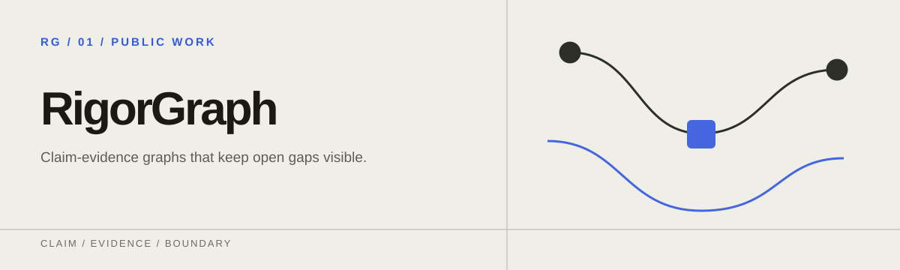
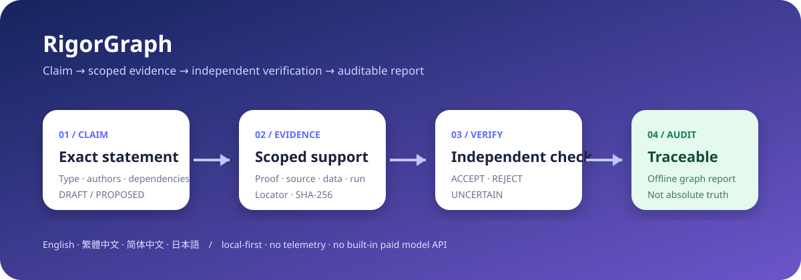

<p align="center">
  
</p>

# RigorGraph

[English](README.md) · [繁體中文](README.zh-TW.md) · [简体中文](README.zh-CN.md) · [日本語](README.ja.md)

**把 AI 研究整理成可审计的命题与证据图。**

RigorGraph 让研究命题始终连着它所依据的证据。每个命题都会记下它说了什么、哪些证据支持它、由谁独立检查过，以及还有哪些缺口没解决。证明、文献支持、数值证据、基准测试证据与不确定性会分开记录，不会混为一谈。它以 CLI、离线报告、GitHub Action 与技能包的形式提供，默认只在本地运行。

> RigorGraph 检查的是工作流是否完整、能否追溯。标成 `VERIFIED` 的命题，代表它已被记录下来的工作流接受，并不代表绝对真理、形式认证、同行评审或专家共识。

> **产品状态：公开测试版。** 已发布的 1.x 公开接口只会以向前兼容的方式添加。外部使用是一种证据，但不是放宽确定性质量门控的理由。公开反馈时请不要附上私人研究数据。



## 快速开始

需要 Python 3.11 或更高版本，不需要 API 密钥。请安装已发布的 1.0.1 软件包；产品目前仍是公开测试版。

```bash
python -m pip install "rigorgraph==1.0.1"
rigorgraph --lang zh-CN demo --scenario math --open
```

这个演示会创建项目、运行确定性审计，并打开一个自包含的报告。你也可以试试刻意设计的错误晋升：

```bash
rigorgraph --lang zh-CN demo invalid-demo --scenario invalid
rigorgraph --lang zh-CN audit invalid-demo
```

第二次审计会拒绝把有限的数值扫描当成形式证明。

### 创建自己的项目

```bash
rigorgraph --lang zh-CN quickstart 我的研究 --name "我的研究项目" --author "你的名字" --type formal --statement "每个有界数列都具有性质 P。" --open
```

这个命令会用你输入的原文创建一个真实的 `DRAFT` 命题，并打开离线报告。命题会列在“未解缺口”里。RigorGraph 不会替它伪造证据，也不会把它晋升为 `VERIFIED`。项目内容是人看得懂、也能放进版本控制的记录：

```text
我的研究/
├── rigorgraph.yaml
└── .rigorgraph/
    ├── claims.jsonl
    ├── evidence.jsonl
    └── verifications.jsonl
```

## 命令

| 命令 | 用途 |
| --- | --- |
| `rigorgraph quickstart` | 不伪造证据，创建首个 `DRAFT` 命题与可阅读离线报告 |
| `rigorgraph init` | 初始化项目且不覆盖已有文件 |
| `rigorgraph claim add CLAIM.json` | 添加 `DRAFT` 或 `PROPOSED` 命题 |
| `rigorgraph evidence add EVIDENCE.json` | 添加有明确范围的证据；本地文件必须提供 SHA-256 |
| `rigorgraph verify CLAIM_ID --file REVIEW.json` | 记录独立的 `ACCEPT`、`REJECT` 或 `UNCERTAIN` 结果 |
| `rigorgraph audit` | 检查结构、依赖图、证据类别、独立性与哈希 |
| `rigorgraph report` | 生成可切换四种语言的离线 HTML 报告 |
| `rigorgraph demo` | 创建有效数学、有效 benchmark 或刻意无效的演示 |

在命令前加上 `--lang en`、`--lang zh-TW`、`--lang zh-CN` 或 `--lang ja` 可以指定界面语言。没有指定时，会依序采用项目设置、操作系统语言，最后才是英文。

## 审计会强制的规则

- 每个 ID 都是唯一的，所有链接都能找到对象。
- 命题之间的依赖关系不能形成循环。
- 已撤销或已拒绝的命题，不能在暗中继续支持下游命题。
- 命题的作者不能担任自己的独立验证者。
- 标成 `VERIFIED` 必须有一笔独立的 `ACCEPT` 记录。
- 形式命题需要证明，文献命题需要精确的来源位置，实证与 benchmark 命题需要能复现结果的产物。
- 本地证据的路径不能指到项目外面，必要的 SHA-256 也必须相符。
- 一笔 ACCEPT 记录会绑定它实际审查过的那份命题与证据快照。
- 通过工作流验证的综合命题，只能依赖目前同样是 `VERIFIED` 的命题。

用户写的命题、公式、引文与证据都保留原本的语言，只有界面标签会翻译。

## Agent Skills 与 Codex plugin

本仓库包含四个各有专责的技能：[research-intake](skills/research-intake)、[capture-claim](skills/capture-claim)、[adversarial-verify](skills/adversarial-verify) 与 [release-audit](skills/release-audit)。另外也附有原生的 `.codex-plugin/plugin.json`。

在 Codex 中，可以请 `$skill-installer` 从 `f0909172434/rigorgraph` 安装这些技能，或通过支持的本地／plugin marketplace 流程安装整个仓库。

## 隐私与限制

- RigorGraph 默认只在本地运行。它没有账号、遥测、远程数据库，也没有内置的付费模型 API。
- HTML 报告是自包含的单一文件，打开时不会发出网络请求。
- 确定性门控能抓出不完整的记录与错误的晋升，但无法保证人类或 AI 写的证明在数学上是正确的。
- 核心结果仍然需要相应领域的专家审查。

RigorGraph 1.0 可以用 `rigorgraph evidence import BUNDLE.json --claim ID` 保存 HonestCI 等工具产生的版本化证据包。证据包只能连到 `DRAFT` 或 `PROPOSED` 命题，而且导入永远不会自动验证命题。完整的格式约定请看 [Evidence bundles](docs/EVIDENCE_BUNDLES.md)。

从源码开发、GitHub Action 的用法与贡献方式，请看[英文 README](README.md) 与 [CONTRIBUTING.md](CONTRIBUTING.md)。安全边界请看[安全政策](SECURITY.md)与[威胁模型](docs/THREAT_MODEL.md)，发布条件请看[发布政策](docs/RELEASE_POLICY.md)。本项目以 MIT License 授权。

[跨工具串接示例](examples/toolchain/README.md)可以直接运行。它涵盖 HonestCI 的成功、失败与篡改检查、Finite Witness 的重放，以及冻结的 ProofWeave 证据。示例中的所有命题都维持 DRAFT。
