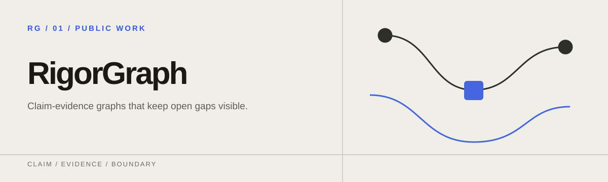
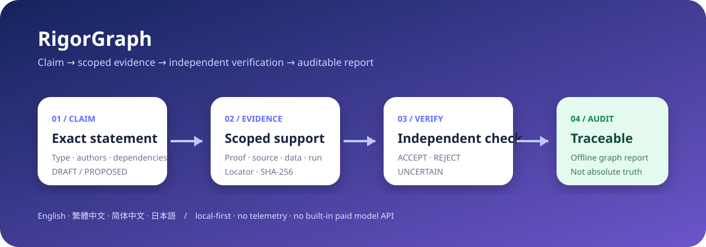

<p align="center">
  
</p>

# RigorGraph

[English](README.md) · [繁體中文](README.zh-TW.md) · [简体中文](README.zh-CN.md) · [日本語](README.ja.md)

**把 AI 研究整理成可稽核的命題與證據圖。**

RigorGraph 讓研究命題始終連著它所依據的證據。每個命題都會記下它說了什麼、哪些證據支持它、由誰獨立檢查過，以及還有哪些缺口沒解決。證明、文獻支持、數值證據、基準測試證據與不確定性會分開記錄，不會混為一談。它以 CLI、離線報告、GitHub Action 與技能包的形式提供，預設只在本機執行。

> RigorGraph 檢查的是工作流程是否完整、能否追溯。標成 `VERIFIED` 的命題，代表它已被記錄下來的工作流程接受，並不代表絕對真理、形式認證、同儕審查或專家共識。

> **產品狀態：公開測試版。** 已發布的 1.x 公開介面只會以向前相容的方式新增。外部使用是一種證據，但不是放寬確定性品質閘門的理由。公開回饋時請不要附上私人研究資料。



## 快速開始

需要 Python 3.11 以上，不需要 API 金鑰。請安裝已發布的 1.0.1 套件；產品目前仍是公開測試版。

```bash
python -m pip install "rigorgraph==1.0.1"
rigorgraph --lang zh-TW demo --scenario math --open
```

這個示範會建立專案、執行確定性稽核，並開啟一個自包含的報告。你也可以試試刻意設計的錯誤晉升：

```bash
rigorgraph --lang zh-TW demo invalid-demo --scenario invalid
rigorgraph --lang zh-TW audit invalid-demo
```

第二次稽核會拒絕把有限的數值掃描當成形式證明。

### 建立自己的專案

```bash
rigorgraph --lang zh-TW quickstart 我的研究 --name "我的研究專案" --author "你的名字" --type formal --statement "每個有界數列都具有性質 P。" --open
```

這個命令會用你輸入的原文建立一個真實的 `DRAFT` 命題，並開啟離線報告。命題會列在「未解缺口」裡。RigorGraph 不會替它捏造證據，也不會把它晉升為 `VERIFIED`。專案內容是人看得懂、也能放進版本控制的紀錄：

```text
我的研究/
├── rigorgraph.yaml
└── .rigorgraph/
    ├── claims.jsonl
    ├── evidence.jsonl
    └── verifications.jsonl
```

## 命令

| 命令 | 用途 |
| --- | --- |
| `rigorgraph quickstart` | 不捏造證據，建立首個 `DRAFT` 命題與可閱讀離線報告 |
| `rigorgraph init` | 初始化專案且不覆寫既有檔案 |
| `rigorgraph claim add CLAIM.json` | 新增 `DRAFT` 或 `PROPOSED` 命題 |
| `rigorgraph evidence add EVIDENCE.json` | 新增具範圍的證據；本機檔案必須提供 SHA-256 |
| `rigorgraph verify CLAIM_ID --file REVIEW.json` | 記錄獨立的 `ACCEPT`、`REJECT` 或 `UNCERTAIN` 結果 |
| `rigorgraph audit` | 檢查結構、依賴圖、證據類別、獨立性與雜湊 |
| `rigorgraph report` | 產生可切換四語的離線 HTML 報告 |
| `rigorgraph demo` | 建立有效數學、有效 benchmark 或刻意無效的示範 |

在命令前加上 `--lang en`、`--lang zh-TW`、`--lang zh-CN` 或 `--lang ja` 可以指定介面語言。沒有指定時，會依序採用專案設定、作業系統語系，最後才是英文。

## 稽核會強制的規則

- 每個 ID 都是唯一的，所有連結都能找到對象。
- 命題之間的依賴關係不能形成循環。
- 已撤銷或已拒絕的命題，不能在暗中繼續支持下游命題。
- 命題的作者不能擔任自己的獨立驗證者。
- 標成 `VERIFIED` 必須有一筆獨立的 `ACCEPT` 紀錄。
- 形式命題需要證明，文獻命題需要精確的來源位置，實證與 benchmark 命題需要能重現結果的產物。
- 本機證據的路徑不能指到專案外面，必要的 SHA-256 也必須相符。
- 一筆 ACCEPT 紀錄會綁定它實際審查過的那份命題與證據快照。
- 通過工作流程驗證的綜合命題，只能依賴目前同樣是 `VERIFIED` 的命題。

使用者寫的命題、公式、引文與證據都保留原本的語言，只有介面標籤會翻譯。

## Agent Skills 與 Codex plugin

本 repo 包含四個各有專責的技能：[research-intake](skills/research-intake)、[capture-claim](skills/capture-claim)、[adversarial-verify](skills/adversarial-verify) 與 [release-audit](skills/release-audit)。另外也附有原生的 `.codex-plugin/plugin.json`。

在 Codex 中，可以請 `$skill-installer` 從 `f0909172434/rigorgraph` 安裝這些技能，或透過支援的本機／plugin marketplace 流程安裝整個 repo。

## 隱私與限制

- RigorGraph 預設只在本機運作。它沒有帳號、遙測、遠端資料庫，也沒有內建的付費模型 API。
- HTML 報告是自包含的單一檔案，開啟時不會發出網路請求。
- 確定性閘門能抓出不完整的紀錄與錯誤的晉升，但無法保證人類或 AI 寫的證明在數學上是正確的。
- 核心結果仍然需要相應領域的專家審查。

RigorGraph 1.0 可以用 `rigorgraph evidence import BUNDLE.json --claim ID` 保存 HonestCI 等工具產生的版本化證據包。證據包只能連到 `DRAFT` 或 `PROPOSED` 命題，而且匯入永遠不會自動驗證命題。完整的格式約定請看 [Evidence bundles](docs/EVIDENCE_BUNDLES.md)。

從原始碼開發、GitHub Action 的用法與貢獻方式，請看[英文 README](README.md) 與 [CONTRIBUTING.md](CONTRIBUTING.md)。安全邊界請看[安全政策](SECURITY.md)與[威脅模型](docs/THREAT_MODEL.md)，發布條件請看[發布政策](docs/RELEASE_POLICY.md)。本專案以 MIT License 授權。

[跨工具串接範例](examples/toolchain/README.md)可以直接執行。它涵蓋 HonestCI 的成功、失敗與竄改檢查、Finite Witness 的重播，以及凍結的 ProofWeave 證據。範例中的所有命題都維持 DRAFT。
